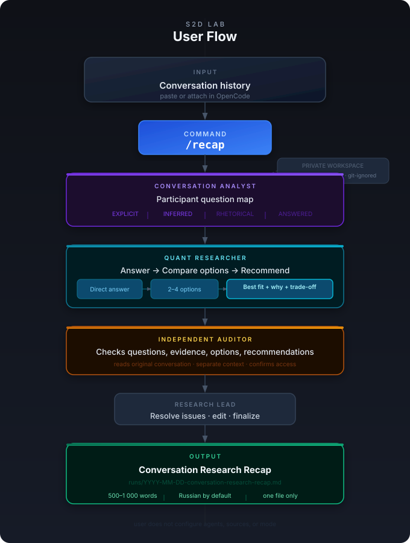

# S2D Lab — Question-First MVP

S2D Lab turns a supplied conversation into one **Conversation Research Recap**.

## User flow

The user does not select agents, sources, or research mode manually.

*For technical workflow details including the bounded verifier/rework loop, see [docs/verifier-loop.md](docs/verifier-loop.md).*

## Agents
- Conversation Analyst — questions, source anchors, participant viewpoints.
- Quant Researcher — answers, options, recommendation.
- Independent Auditor — independent check against original input.
- Research Lead — coordination and final editing.

All agents operate within a bounded verifier/rework loop with maximum 3 revision cycles per artifact, ensuring quality without unbounded iteration. See [docs/verifier-loop.md](docs/verifier-loop.md) for technical details.

## Sources
Prefer primary sources for facts. arXiv is a research discovery source; Investopedia is an educational explainer; StockCharts ChartSchool is restricted by default pending permission/licence confirmation. See `docs/source-policy.md`.

## Run
1. Telegram Desktop → chat → ⋮ → **Export chat history**: format **HTML**, enable **Photos**, pick the period. Default location: `~/Downloads/Telegram Desktop/ChatExport_YYYY-MM-DD/`.
2. Open the repository in OpenCode and run:
   - `/recap` — newest export of `investment-decisions-with-ml`;
   - `/recap "/path/to/ChatExport_2026-11-10"` — a specific export;
   - `/recap --chat "other-group"` — newest export of another chat.

The whole export (all messages and photos) is converted to `runs/.work/<run-id>/source.md` + `images/` by `scripts/tg_export_to_source.py`. A conversation pasted into the session still works and takes precedence. Each photo is described once by a vision model (verbatim text, numbers, chart contents; cached in `runs/.work/.image-descriptions/`) and the description is inserted under the photo link. Agents work from the descriptions and open an image only when a material claim rests on it; the auditor checks those against the original. Endpoint: `S2D_VISION_URL` / `S2D_VISION_KEY` / `S2D_VISION_MODEL` (default: x99); `--no-describe` skips it. The vLLM server must allow enough images per prompt (`--limit-mm-per-prompt '{"image": 16}'`), since an agent's opened images accumulate in its context.
