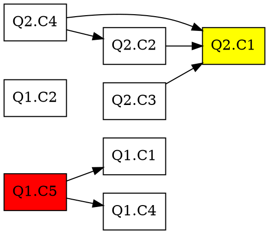

# D2 Implementation Plan — Claim Dependency Graph

**Date:** 2026-11-08  
**Session:** 05  
**Prerequisites:** C1 complete (validator + schema conformance)

## Objective

Build claim dependency graph validator and visualizer to enable proper differential audit scope calculation.

## Current State

From `scripts/validate-artifact.py` (C1):
- ✅ Claim ID format validation (`Q\d+\.C\d+`)
- ✅ Self-dependency detection (Q1.C1 → Q1.C1 = error)
- ✅ `depends_on` parsing from markdown
- ❌ **Missing:** Existence check (deps reference valid claims)
- ❌ **Missing:** Cycle detection (DAG enforcement)
- ❌ **Missing:** Transitive scope calculation
- ❌ **Missing:** Visualization

From `docs/artifact-schema.md` (VALIDATED):
- Dependency validation rules documented (existence, no self-ref, no cycles, no dangling, scope propagation)
- Pseudocode examples provided

## D2 Scope

### D2.1: Validator Enhancement
**File:** `scripts/validate-artifact.py`

Add to `_validate_research_packet`:
1. **Existence check:** All `depends_on` references must exist in the same artifact
   - Build set of all claim IDs in body
   - For each claim's `depends_on` list, verify each dep_id in claim_id_set
   - Error: "Claim {cid}: depends_on references non-existent claim {dep_id}"

2. **Cycle detection (DAG):** Dependency graph must be acyclic
   - Build adjacency list: `graph[claim_id] = depends_on_list`
   - Run DFS with visited/rec_stack tracking
   - Error: "Claim dependency cycle detected: {cycle_path}"

3. **Transitive scope calculation** (helper function, not validation):
   - `get_recheck_scope(changed_claim_ids: set, all_claims: dict) -> set`
   - Input: changed claims from CRs
   - Output: changed + all claims that depend on changed (transitive)
   - Used by auditor/state validator (D3 input)

### D2.2: Graph Visualizer
**File:** `scripts/visualize-claim-graph.py` (new)

**Usage:** `uv run --with pyyaml --with graphviz scripts/visualize-claim-graph.py <research-packet-path> [--output graph.svg]`

**Features:**
- Parse Research Packet, extract claims + depends_on
- Build directed graph (claim_id → depends_on edges)
- Visualize with graphviz (DOT format)
- Node labels: claim IDs
- Edge labels: dependency relationship
- Output: SVG/PNG/DOT
- Highlight: changed claims (if provided via --changed Q1.C1,Q1.C2)
- Color: changed claims (red), dependent claims (yellow), unchanged (white)

**Graphviz format:**

### D2.3: Testing

**Validator tests (manual, using gate-set artifacts):**
1. `fx01` Research Packet v1: valid dependencies (Q1.C5 → Q1.C1, Q1.C4; Q2.C2 → Q2.C1; etc.)
2. Synthetic negative test: self-dependency (Q1.C1 → Q1.C1) — already catches
3. Synthetic negative test: non-existent reference (Q1.C5 → Q9.C99)
4. Synthetic negative test: cycle (Q1.C1 → Q1.C2 → Q1.C1)

**Visualizer tests:**
1. `fx01` Research Packet v1: generate graph.svg, confirm 12 claims + edges
2. `fx06` Research Packet v1: before/after CR (v1 vs v2)
3. `fx07` Research Packet v1-v4: progression across cycles

## Implementation Order

1. **D2.1.1:** Existence check (20 lines)
2. **D2.1.2:** Cycle detection (40 lines, DFS helper)
3. **D2.1.3:** Transitive scope helper (30 lines, separate function)
4. **D2.2:** Graph visualizer script (150-200 lines, new file)
5. **D2.3:** Testing on gate-set artifacts
6. **Documentation:** Update `docs/artifact-schema.md` "Implementation Notes" (validator now enforces dependency rules)

## Expected Deliverables

- ✅ `scripts/validate-artifact.py` enhanced (D2.1.1–D2.1.3)
- ✅ `scripts/visualize-claim-graph.py` (new, D2.2)
- ✅ Manual test results documented (D2.3)
- ✅ `docs/artifact-schema.md` updated (implementation status)
- ✅ Session-05 summary with D2 completion report

## Non-Goals (Out of Scope)

- Automated E1 structural tests (deferred to E1 milestone)
- State.yaml integration (deferred to D3)
- Auditor prompt changes (not needed — auditor already references `depends_on` in recheck scope per B2-followup)
- Research-lead dispatch changes (not needed — schema already documented)

## Acceptance Criteria

- [ ] Validator detects non-existent dependency references (ERROR)
- [ ] Validator detects cycles (ERROR with path)
- [ ] Validator passes fx01/fx03/fx06/fx07 gate-set artifacts (all valid)
- [ ] Transitive scope calculator tested with synthetic examples
- [ ] Visualizer generates SVG for fx01 Research Packet v1
- [ ] Visualizer highlights changed claims + dependents (manual test with --changed)
- [ ] `docs/artifact-schema.md` updated with "D2 complete" marker
- [ ] Session-05 summary created

## Token Impact

Minimal — no prompt changes; scripts are external tooling.

## Dependencies

- **Requires:** C1 complete (validator exists, schema VALIDATED)
- **Blocks:** D3 (state validator needs transitive scope calculation)
- **Blocks:** E1 (structural tests will use enhanced validator)

---

**Status:** DRAFT  
**Next:** Begin D2.1.1 (existence check)
